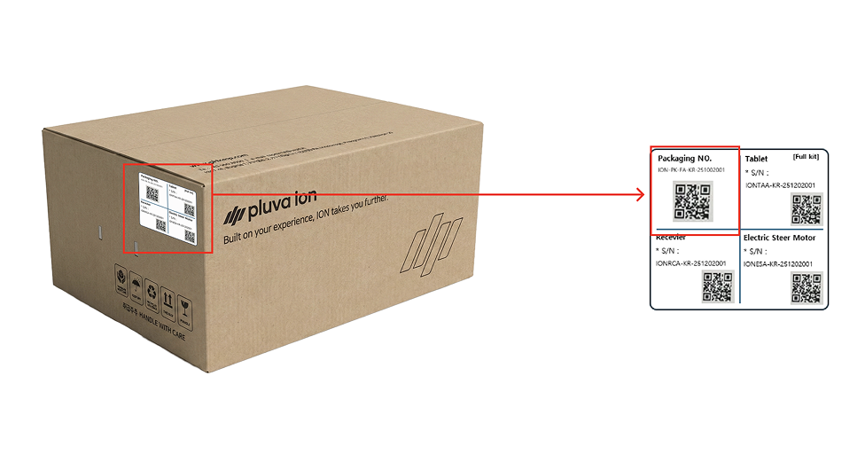
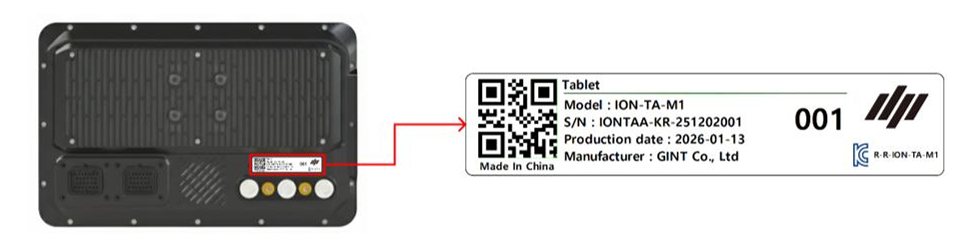
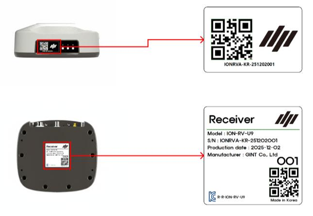
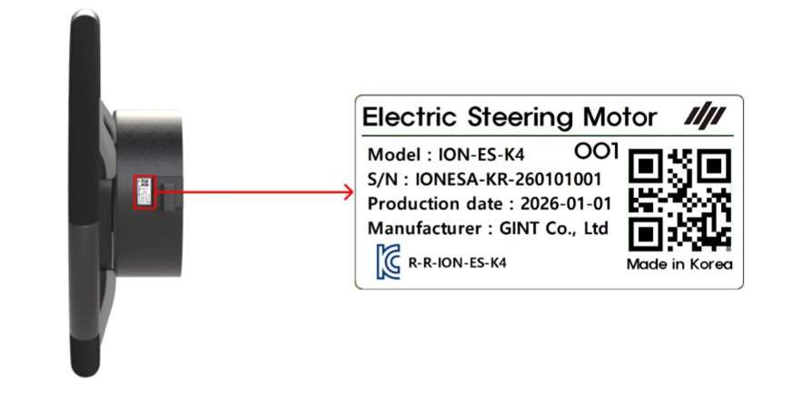
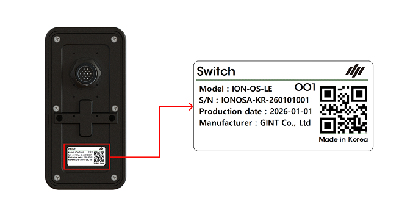
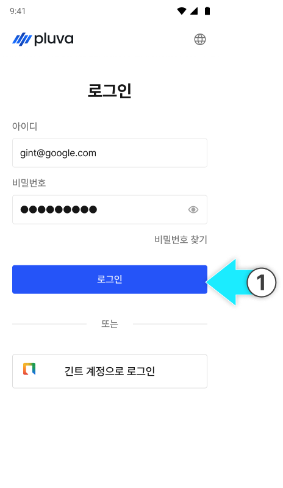

---
layout:
  width: default
  title:
    visible: true
  description:
    visible: false
  tableOfContents:
    visible: true
  outline:
    visible: true
  pagination:
    visible: true
  metadata:
    visible: true
  tags:
    visible: true
  actions:
    visible: true
  anchors:
    visible: true
tags:
  - tag: jp
    primary: true
---

# 설치티켓으로 제품 개통

설치 티켓에 제품과 구성품을 등록해 설치를 시작합니다. 퀵셋업 전에 등록을 완료해 주세요.


**설치 티켓이 무엇인가요?**

설치할 제품과 구성품을 등록하고 설치 진행 상태를 관리하는 티켓입니다.


***

#### 주문 제품별 개통 구성품 

설치할 제품에 맞는 구성품을 준비해 주세요.

**1. 플루바 아이온**

* 태블릿
* GNSS 수신기
* 전동 스티어링 휠

<figure><figcaption></figcaption></figure>

**2. 플루바 아이온 Expansion Kit (확장키트)**

* GNSS 수신기
* 전동 스티어링 휠

<figure><figcaption></figcaption></figure>

**3. 추가 옵션**

* 스위치

<figure><figcaption></figcaption></figure>

***

#### 시리얼 넘버 등록 (패키징 넘버) 

제품 등록은 제품에 부착된 QR 코드(시리얼 넘버 혹은 패키징 넘버)를 스캔해 진행합니다.

* 패키징 넘버(패키지 박스 QR)를 등록하면, 구성품을 **한 번에 등록**할 수 있습니다.

#### QR 코드 위치 안내

#### 패키지 시리얼 넘버


{% column width="58.333333333333336%" %}
박스 측면의 QR코드를 확인합니다.

<figure><figcaption></figcaption></figure>


{% column width="41.666666666666664%" %}




#### 개별 시리얼 넘버



**태블릿**

후면의 QR코드를 확인합니다.

<figure><figcaption></figcaption></figure>



**GNSS 수신기**

우측면 또는 하단의 QR 코드를 확인합니다.

<figure><figcaption></figcaption></figure>





**전동 스티어링 휠**

모터 측면에 QR 코드를 확인합니다.

<figure><figcaption></figcaption></figure>



**스위치**

후면의 QR코드를 확인합니다.

<figure><figcaption></figcaption></figure>



***

#### 설치 티켓 목록 진입 방법



[어드민 페이지](https://gint-admin.pluva.kr/auth/operators/login)에 로그인합니다.

<figure><figcaption></figcaption></figure>




설치 관리 → 설치 티켓 목록에 진입하고 \[설치 등록]을 누릅니다.

<figure><figcaption></figcaption></figure>


왼쪽 상단 더보기 버튼을 누르고 설치 관리 > 설치 목록에 접속할 수 있습니다.

.png>)




***

#### 제품 개통 방법

아래는 플루바 아이온 기본키트의 개통 절차입니다. 확장키트나 스위치를 등록할 때 달라지는 내용은 각 단계의 안내를 참고해 주세요.



담당 조직과 설치할 제품을 선택합니다.

<figure><figcaption></figcaption></figure>




설치 제품에서 \[플루바 아이온]을 선택합니다.

<figure><figcaption></figcaption></figure>


**확장키트나 스위치만 등록하는 경우**

* **확장키트:** \[Expansion Kit]을 선택하고 GNSS 수신기와 전동 스티어링 휠을 등록합니다.
* **스위치만 등록:** 설치 제품에서 \[스위치]만 선택하고 \[등록 시작]을 누릅니다.




선택한 제품과 옵션을 확인한 후 \[등록 시작]을 누릅니다.

<figure><figcaption></figcaption></figure>




\[패키지로 한번에 개통]을 눌러 주요 제품을 개통합니다.

<figure><figcaption></figcaption></figure>


**구성품을 개별 등록하는 경우**

등록할 구성품을 선택한 후 QR 코드를 스캔하거나 시리얼 번호를 직접 입력해 주세요.

.png>)




패키지 QR 코드를 카메라로 스캔합니다.

<figure><figcaption></figcaption></figure>


**바코드 촬영 시 참고 사항**

* QR코드를 화면 가득 확대해 주세요.
* 초점을 선명하게 맞춰주세요.



**QR 코드가 인식되지 않는 경우**

\[패키지 번호 직접 입력]을 눌러 패키지 번호를 입력해 주세요.

.png>)




패키지 번호를 확인한 뒤 \[확인 완료]를 누릅니다.

<figure><figcaption></figcaption></figure>




스캔이 완료되면 \[다음]을 누릅니다.

<figure><figcaption></figcaption></figure>


**스위치만 등록하는 경우**

스위치의 QR 코드 또는 시리얼 번호 등록을 마치고 \[다음]을 누르면 \[사용 계정 선택] 화면이 나타납니다.

.png>)




등록할 제품과 구성품의 시리얼 번호가 빠짐없이 등록되었는지 확인한 후 \[등록]을 누릅니다.

<figure><figcaption></figcaption></figure>


**등록 정보를 수정해야 하는 경우**

* 시리얼 번호나 유심 정보를 수정하려면 해당 항목의 \[재등록]을 누릅니다.
* 이전 단계의 정보를 다시 확인하려면 화면 아래의 \[이전]을 누릅니다.

.png>)




확인 창에서 \[등록 완료]를 누릅니다.

<figure><figcaption></figcaption></figure>




설치 티켓이 \[설치 중] 상태로 변경되며 제품 등록이 완료됩니다.

<figure><figcaption></figcaption></figure>


**설치 티켓 완료 시점**

* **기본 키트**: 태블릿에서 고객 계정 로그인을 완료하면 티켓이 자동으로 완료됩니다.
* **확장 키트**: 등록한 장비가 추가 차량에 연결되면 티켓이 자동으로 완료됩니다.



티켓이 완료되기 전에는 설치 등록을 취소할 수 있습니다.




***

#### 이후 단계

[제품 설치](product-installation/)를 완료해 주세요.
