---
layout:
  width: default
  title:
    visible: true
  description:
    visible: false
  tableOfContents:
    visible: true
  outline:
    visible: true
  pagination:
    visible: true
  metadata:
    visible: true
  tags:
    visible: true
  actions:
    visible: true
  anchors:
    visible: true
---

# 경로 불러오기

저장한 경로를 불러오거나, 즐겨찾기/이름 수정/삭제로 관리할 수 있습니다.

***

#### 경로 불러오기


경로 불러오기 목록에는 **\[경로 저장]으로 저장해 둔 경로만** 표시되며, 그중 **현재 선택한 주행 모드에 해당하는 경로만** 나타납니다.




 \[작업] 버튼을 누릅니다.

<figure>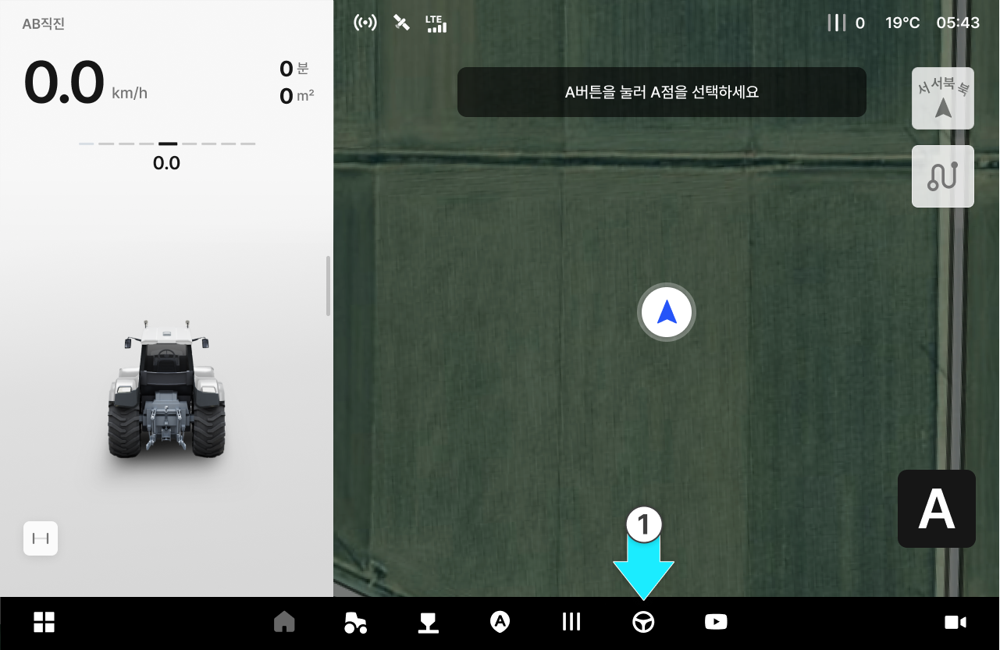<figcaption></figcaption></figure>



경로 불러오기를 누릅니다.

<figure>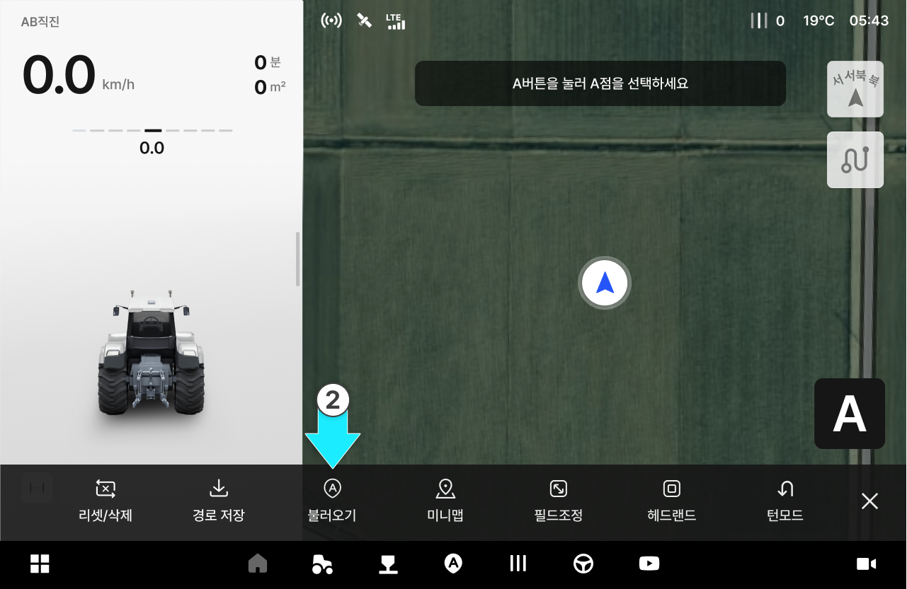<figcaption></figcaption></figure>


스마트커브 경로는 해당 경로를 저장한 차량에서만 확인할 수 있습니다.




원하는 경로를 선택하고 \[불러오기]를 누릅니다.

<figure>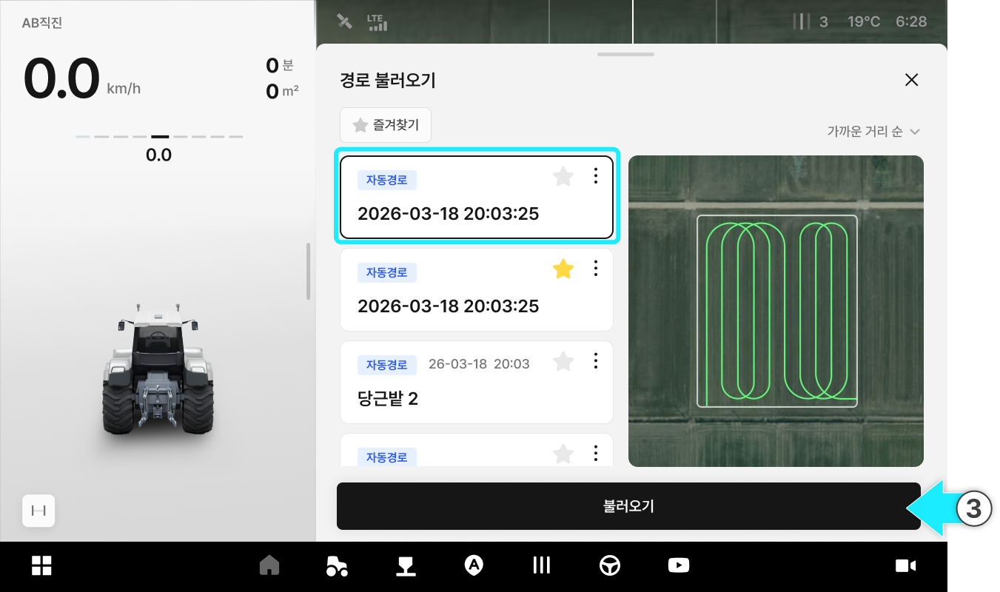<figcaption></figcaption></figure>



경로 불러오기 팝업에서 \[불러오기]를 누른다.

<figure>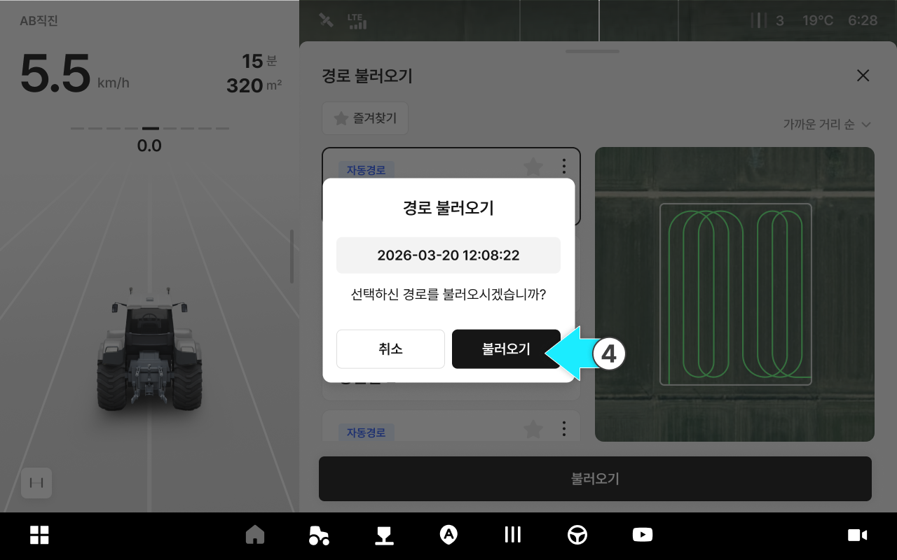<figcaption></figcaption></figure>



경로가 성공적으로 불러와집니다.

<figure>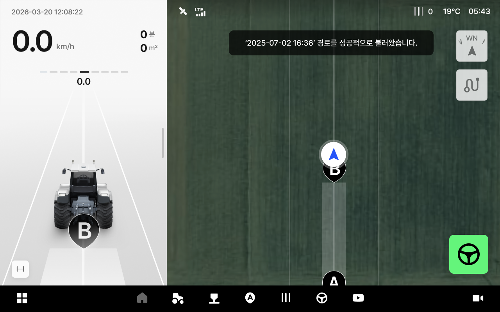<figcaption></figcaption></figure>



***

#### 불러올 경로 이름 수정



불러올 경로의  아이콘을 누릅니다.

<figure><figcaption></figcaption></figure>



이름 수정 옵션을 선택합니다.

<figure>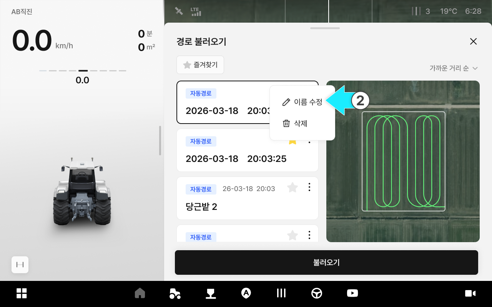<figcaption></figcaption></figure>



수정할 이름을 입력합니다.

<figure>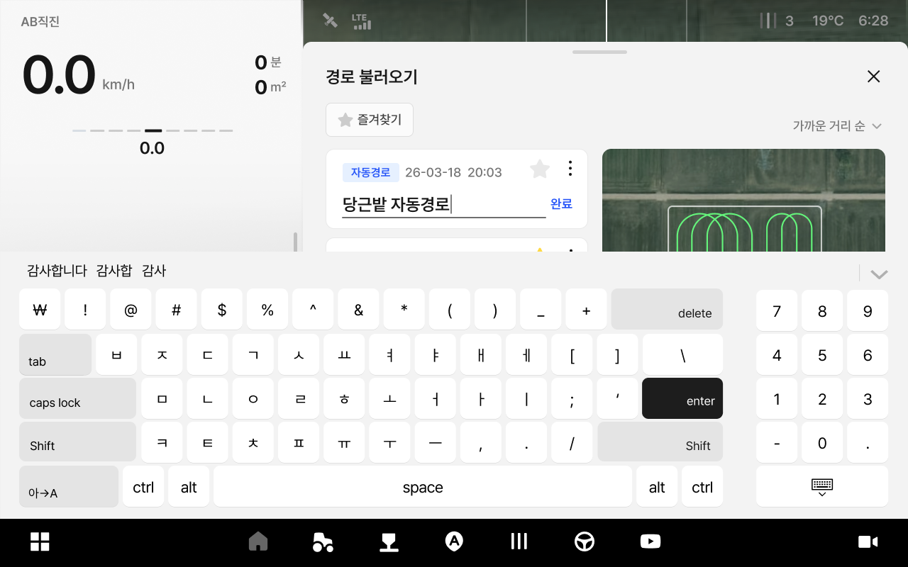<figcaption></figcaption></figure>



이름 수정이 완료됩니다.

<figure>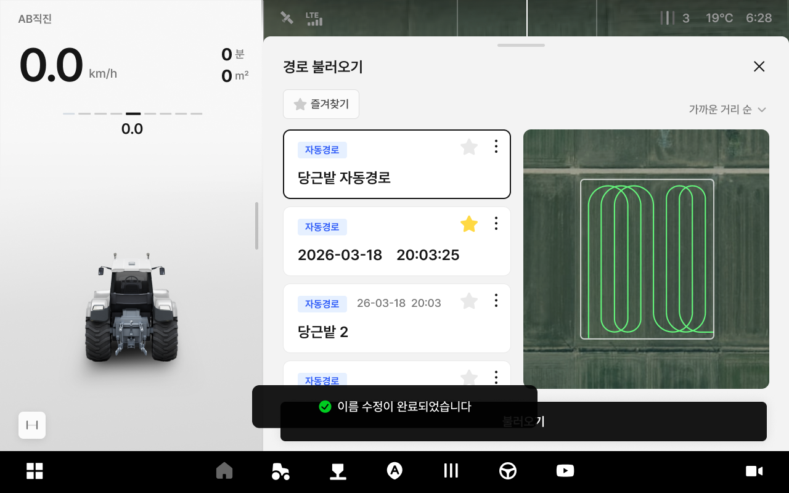<figcaption></figcaption></figure>



***

#### 경로 불러오기 삭제



삭제할 경로의  아이콘을 누릅니다.

<figure>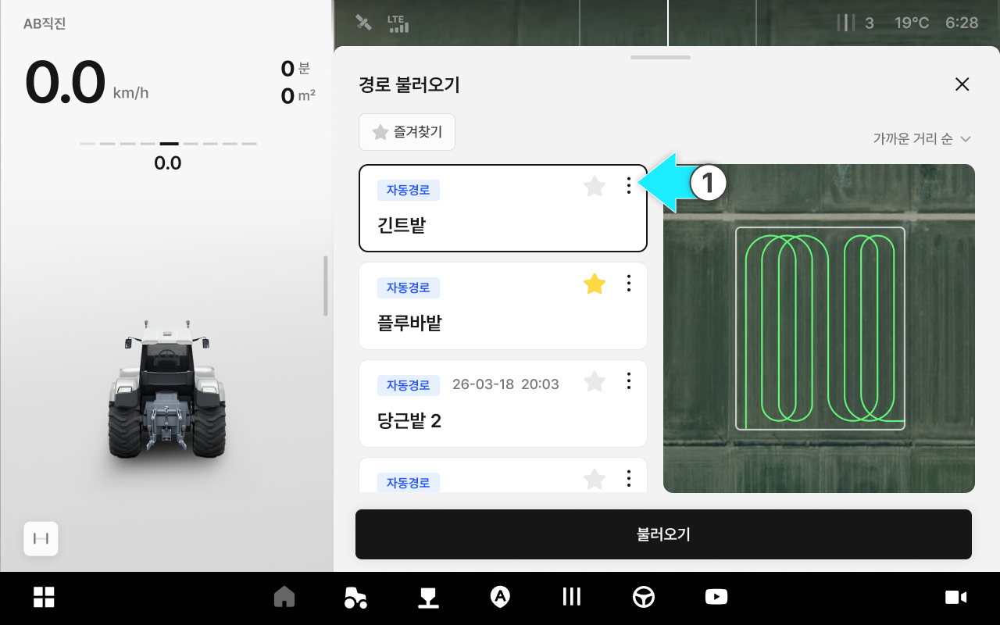<figcaption></figcaption></figure>



삭제 옵션을 선택합니다.

<figure>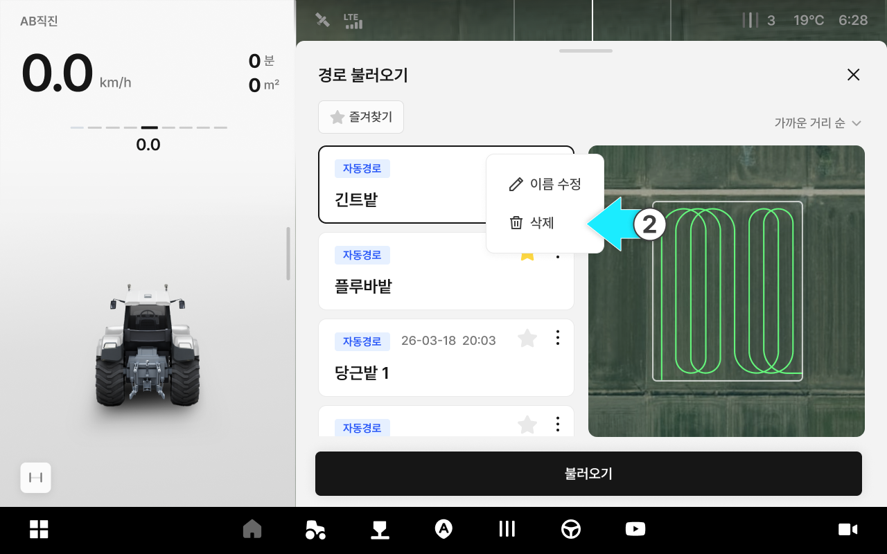<figcaption></figcaption></figure>



모달의 \[삭제] 버튼을 누릅니다.

<figure>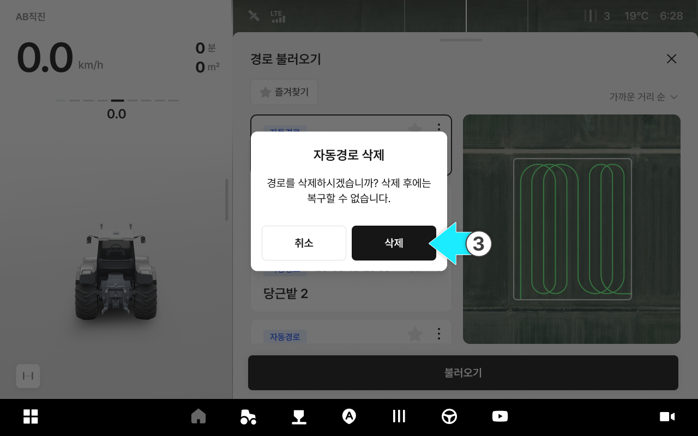<figcaption></figcaption></figure>



저장된 경로가 삭제됩니다.

<figure>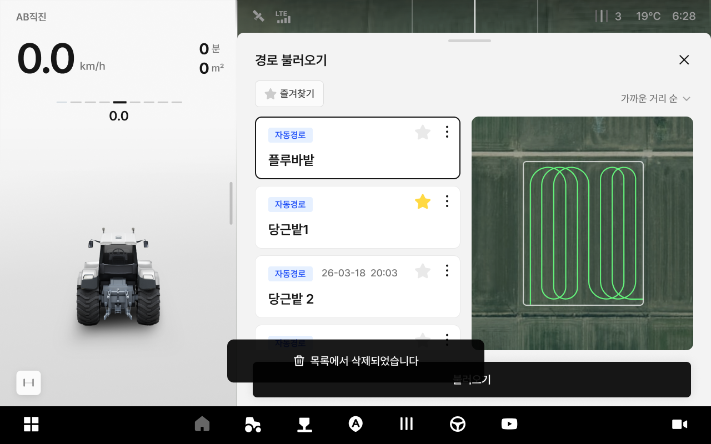<figcaption></figcaption></figure>



***

#### 경로 불러오기 즐겨찾기 등록



즐겨찾기를 하고자하는 항목의  즐겨찾기 아이콘을 누릅니다.

<figure><figcaption></figcaption></figure>



즐겨찾기 저장이 완료됩니다.

<figure>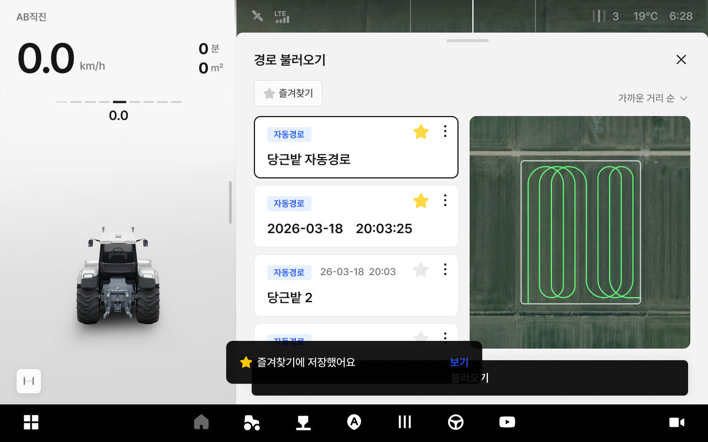<figcaption></figcaption></figure>


즐겨찾기 버튼을 누르면 즐겨찾기에 저장된 경로들만 모아 볼 수 있다.




즐겨찾기 삭제는 즐겨찾기 아이콘을 다시 누르면 바로 삭제됩니다.

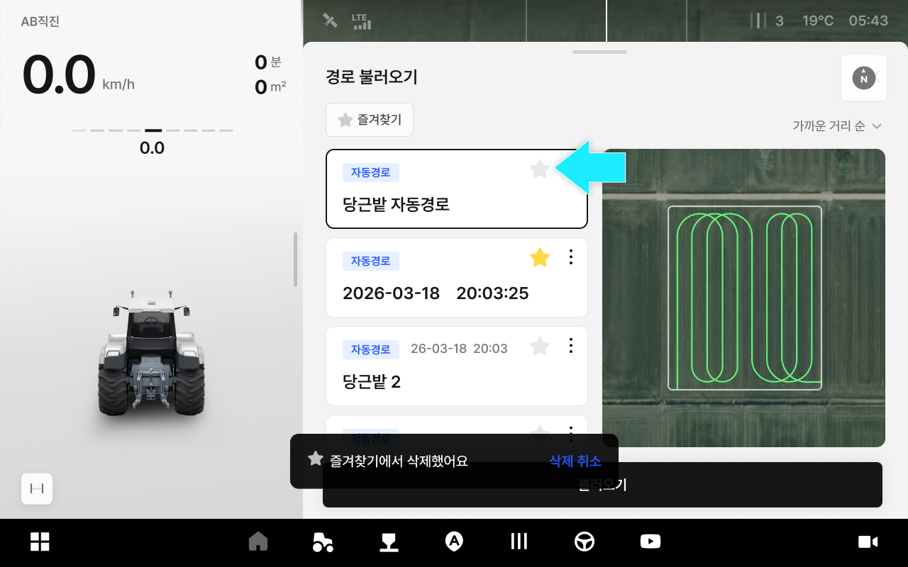



