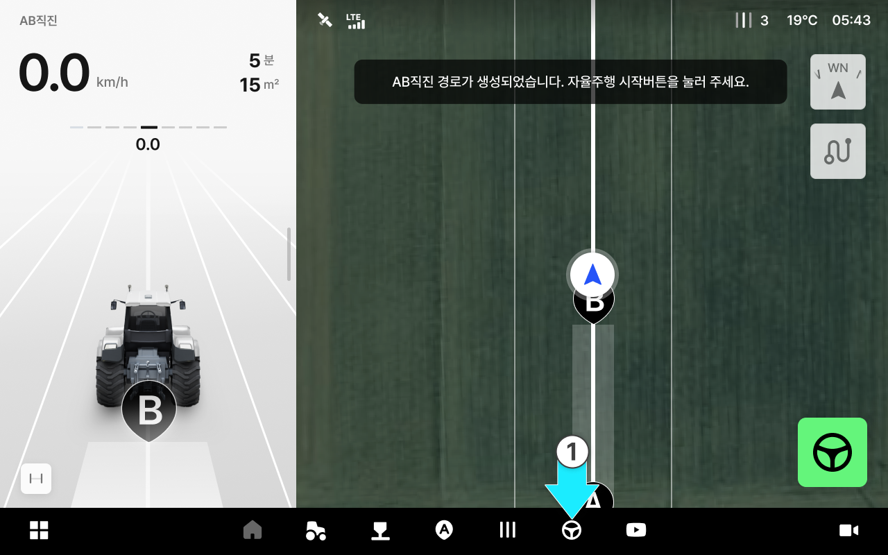
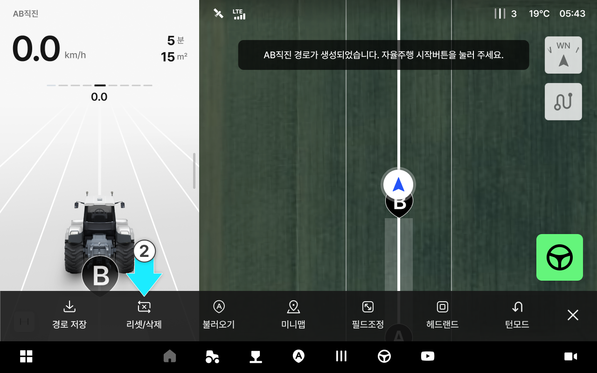

---
layout:
  width: default
  title:
    visible: true
  description:
    visible: false
  tableOfContents:
    visible: true
  outline:
    visible: true
  pagination:
    visible: true
  metadata:
    visible: true
  tags:
    visible: true
  actions:
    visible: true
  anchors:
    visible: true
---

# 경로 리셋/삭제

지도에 표시된 주행 흔적을 지우거나 현재 주행 경로를 초기화할 수 있습니다.



주행 화면 하단의  \[작업] 버튼을 누릅니다.

<figure><figcaption></figcaption></figure>



\[리셋/삭제]를 누릅니다

<figure><figcaption></figcaption></figure>



팝업에서 원하는 기능을 누릅니다.

<figure><figcaption></figcaption></figure>

**경로 리셋**: 현재 AB 경로와 지나온 흔적을 지우고, 화면에 표시된 작업 시간과 면적을 초기화합니다.

**주행라인 제거**: 지도에서 지나온 흔적만 지웁니다. 같은 AB 경로로 이어서 주행할 수 있습니다.

**취소**: 팝업을 닫습니다.


