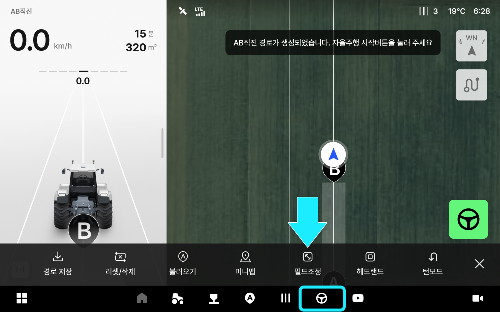

---
layout:
  width: default
  title:
    visible: true
  description:
    visible: false
  tableOfContents:
    visible: true
  outline:
    visible: true
  pagination:
    visible: true
  metadata:
    visible: true
  tags:
    visible: true
  actions:
    visible: true
  anchors:
    visible: true
---

# Copy of 필드 조정

등록한 필드의 경계와 진입·진출 위치를 수정합니다. 차량 위치를 기준으로 조정하거나, 지도에서 이동 거리와 방향을 조절해 조정할 수 있습니다.

***

### 필드 조정 시작하기



 전체 메뉴 아이콘을 누릅니다.

<figure><figcaption></figcaption></figure>



\[My Farm] → \[농장 관리] → \[필드]로 이동합니다.

<figure><figcaption></figcaption></figure>


**작업 화면에서 바로 조정하기**

\[작업 옵션] → \[필드 조정]에서도 현재 선택한 필드를 조정할 수 있습니다.





조정할 필드의  아이콘을 누릅니다.

<figure><figcaption></figcaption></figure>



\[필드 조정]을 선택합니다.

<figure><figcaption></figcaption></figure>



조정 방법을 선택하고 \[확인]을 누릅니다.

* **차량 위치로 조정:** 차량을 이동해 경계를 조정합니다.
* **지도에서 조정:** 지도에서 이동 거리와 방향을 조절해 경계를 조정합니다.

<figure><figcaption></figcaption></figure>



***

### 차량 위치로 조정하기

차량을 이동해 필드 경계의 점이나 선을 현재 차량 위치에 맞춰 조정합니다.


**차량으로 조정할 때 확인해 주세요.**

선택한 뒷바퀴를 기준으로 경계가 조정됩니다. \[조정 가이드]에서 기준 위치를 확인하고, 저속 주행하거나 정차한 상태에서 진행해 주세요.


<strong>점으로 조정하는 방법</strong> 누르면 상세 설명이 열립니다.



\[점으로 조정]을 선택합니다.

<figure><figcaption></figcaption></figure>



기준으로 사용할 \[왼쪽 뒷바퀴] 또는 \[오른쪽 뒷바퀴]를 선택하고 \[다음]을 누릅니다.

<figure><figcaption></figcaption></figure>



원하는 위치로 차량을 이동합니다.


**조정할 점 선택하기**

* 지도에서 원하는 번호를 누르면 조정할 점이 선택됩니다.
* \[지금 위치로 점 조정]을 누르면 선택한 점이 현재 차량 위치를 기준으로 이동합니다.


<figure><figcaption></figcaption></figure>



선택한 점을 확인하고 \[지금 위치로 점 조정]을 누릅니다.

<figure><figcaption></figcaption></figure>



변경된 경계를 확인하고 \[필드 조정 완료]를 눌러 저장합니다.

<figure><figcaption></figcaption></figure>



<strong>선으로 조정하는 방법</strong> 누르면 상세 설명이 열립니다.



\[선으로 조정]을 선택합니다.

<figure><figcaption></figcaption></figure>



기준으로 사용할 \[왼쪽 뒷바퀴] 또는 \[오른쪽 뒷바퀴]를 선택하고 \[다음]을 누릅니다.

<figure><figcaption></figcaption></figure>



원하는 위치로 차량을 이동합니다.


**조정할 선 선택하기**

* 지도에서 원하는 번호를 누르면 조정할 선이 선택됩니다.
* \[지금 위치로 선 조정]을 누르면 선택한 선이 현재 차량 위치를 기준으로 이동합니다.


<figure><figcaption></figcaption></figure>



선택한 선을 확인하고 \[지금 위치로 선 조정]을 누릅니다.

<figure><figcaption></figcaption></figure>



변경된 경계를 확인하고 \[필드 조정 완료]를 눌러 저장합니다.

<figure><figcaption></figcaption></figure>



### 지도에서 조정하기

지도에서 이동 거리와 방향을 조절해 필드 경계의 점이나 선을 조정합니다.

<strong>점으로 조정하는 방법</strong> 누르면 상세 설명이 열립니다.



\[점으로 조정]을 선택합니다.

<figure><figcaption></figcaption></figure>



\[조정할 점] 목록에서 점 번호를 선택합니다.

<figure><figcaption></figcaption></figure>


지도에서 점 번호를 눌러 선택할 수도 있습니다.




\[-]와 \[+]로 이동 거리 값을 조절합니다.

<figure><figcaption></figcaption></figure>



상하좌우 방향 버튼을 눌러 점을 원하는 방향으로 옮깁니다.

<figure><figcaption></figcaption></figure>



변경된 경계를 확인하고 \[필드 조정 완료]를 눌러 저장합니다.

<figure><figcaption></figcaption></figure>



<strong>선으로 조정하는 방법</strong> 누르면 상세 설명이 열립니다.



\[선으로 조정]을 선택합니다.

<figure><figcaption></figcaption></figure>



\[조정할 선] 목록에서 선 번호를 선택합니다.

<figure><figcaption></figcaption></figure>



\[거리 입력]의 \[-]와 \[+]로 이동 거리를 조절합니다.

<figure><figcaption></figcaption></figure>


**선의 이동 방향**

* 음수(-)는 필드 안쪽으로, 양수(+)는 필드 바깥쪽으로 이동합니다.
* 예를 들어 -12cm는 선택한 선을 필드 안쪽으로 12cm 옮기는 값입니다.




변경된 경계를 확인하고 \[필드 조정 완료]를 눌러 저장합니다.

<figure><figcaption></figcaption></figure>



***

### 공통 기능 설명

차량 위치로 조정하거나 지도에서 조정할 때 공통으로 사용하는 기능입니다. 화면 하단에서 진입·진출 위치를 수정하거나, 조정 내용을 되돌리고 화면을 나갈 수 있습니다.

<figure><figcaption></figcaption></figure>

 **진입로 수정**

* 지도에서 진입 아이콘을 원하는 위치로 드래그합니다.

 **진출로 수정**

* 지도에서 진출 아이콘을 원하는 위치로 드래그합니다.

 **선 초기화·점 초기화**

* 선이나 점의 조정 내용을 되돌립니다.

 **초기화**

* 필드 조정 내용을 되돌립니다.

 **나가기**

* 조정을 중단합니다. 변경 내용은 저장되지 않습니다.
