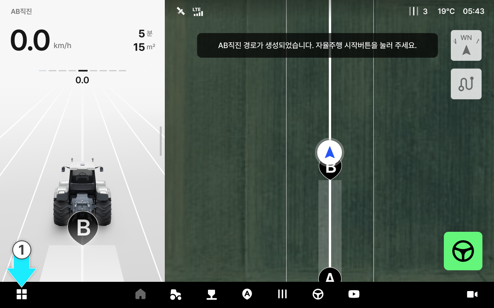

---
tags:
  - tag: jp-fkk
    primary: true
---

# 기기 설정

태블릿의 화면 밝기와 음량, 카메라 표시, 지도 및 블루투스 연결을 설정합니다.

***

### 진입 방법



앱 하단 내비게이션에서 설정 아이콘을 누릅니다.

<figure><figcaption></figcaption></figure>



왼쪽 메뉴에서 \[기기 설정]을 누르면 기기 설정 화면으로 들어갑니다.

<figure><figcaption></figcaption></figure>



***

### 화면 설정

화면 밝기와 음량, 카메라 표시를 설정합니다.

<figure><figcaption></figcaption></figure>

&#x20; **화면 밝기**

* 슬라이더를 드래그하여 화면 밝기를 조절합니다.

 **음량**

* 슬라이더를 드래그하여 음량을 조절합니다.
  * **예시 듣기**: 설정한 음량을 미리 들어봅니다.
  * **음량 초기화**: 음량을 기본값으로 되돌립니다.

 **카메라**

* 주행 화면에 카메라 영상 표시 여부를 설정합니다.
  * **전체 카메라**: 카메라를 한 번에 켜거나 끕니다.
  * **유턴 시 자동 켜짐**: 유턴할 때 카메라가 자동으로 켜집니다.

***

### 지도 설정

주행시 표시되는 지도 소스를 선택할 수 있습니다.

<figure><figcaption></figcaption></figure>

* **구글 지도**: 구글에서 제공하는 위성 사진 데이터를 사용합니다.
* **2D 지도**: 위성 사진이 아닌 평면 지도를 사용합니다.

***

### 입력설정

키보드 입력 방식을 선택합니다.

<figure><figcaption></figcaption></figure>


유튜브 검색 시에는 가나 입력이 되지 않으며, 로마자만 입력할 수 있습니다.



**키보드 업데이트가 필요한 경우**

키보드 업데이트가 필요하면 화면에 “키보드 업데이트가 필요합니다” 안내와 \[지금 설치] 버튼이 표시됩니다.

.png>)

\[지금 설치]를 누르면 업데이트가 진행됩니다.


***

### 기기 정보

기기의 기본 정보를 확인하고 저장된 작업 데이터를 초기화 할 수 있습니다.

<figure><figcaption></figcaption></figure>

 기기 일련번호

* 기기의 일련번호가 표시됩니다.

 데이터 초기화

* 등록된 연결정보를 모두 해제하고 초기 설정 상태로 되돌립니다.
* 데이터 초기화 시 초기 화면으로 이동하여 퀵셋업을 처음부터 다시합니다.


주의: 데이터 초기화 시 모든 데이터가 영구 삭제되며 복구할 수 없습니다.


***

### 블루투스 연결 

주변 블루투스 기기를 태블릿에 연결하고, 연결 상태와 음량을 관리합니다.

<figure><figcaption></figcaption></figure>

 **블루투스 연결**

* 블루투스를 연결을 켜거나 끕니다.

 **등록된 기기**

* 등록한 기기와 연결 상태를 확인합니다. \[연결] 또는 \[연결 해제]를 눌러 연결을 관리합니다.
* ⓘ를 누르면 기기 정보를 확인하거나 \[기기 지우기]를 선택할 수 있습니다.

 **블루투스 음량**

* 슬라이더로 음량을 조절합니다. \[예시 듣기]를 눌러 소리를 확인할 수 있습니다.

 **근처 기기**

* 주변에서 검색된 기기를 확인합니다. \[기기 검색]을 누르면 이름으로 기기를 찾을 수 있습니다.


**새 기기를 연결하는 방법**

블루투스를 켠 뒤, \[근처 기기] 목록에서 연결할 기기의 \[연결]을 누르세요. 연결이 완료되면 \[연결됨]으로 표시됩니다.

